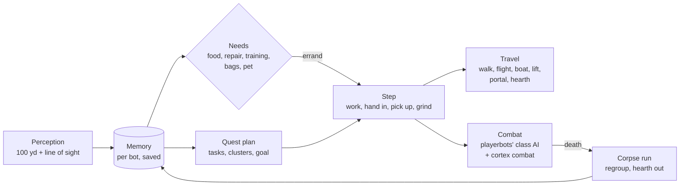

# mod-cortex

**A player-like brain for mod-playerbots' random bots**

It knows how to play the game, not the world. Each bot learns the world from what it sees, and plans its quests the
way a player reads them.

From the live realm's telemetry: 34,000 Cortex bot-hours against 11,800 control bot-hours. Over these days Cortex
bots gained levels 1.8× as fast and turned in 2.4× as many quests, with 14% fewer deaths.

## What it does

| | |
|---|---|
| **Sees, doesn't read tables** | Perception covers 100 yd with line of sight: NPCs and their services, mobs and their levels, quest sparkles, herb and ore nodes. No spawn or loot table reads, no undiscovered flight points, no teleport unsticks. |
| **Remembers** | Each bot's memory (NPCs, mobs, drops, deaths, places it got stuck, quests it set aside) is saved per bot and survives restarts. |
| **Plans like a quest log** | Quest objectives, map areas and the "!" and "?" markers become tasks. Tasks are grouped into nearby clusters, and the bot picks one goal at a time: work, hand in, pick up or grind. |
| **Looks after itself** | It buys food and water, repairs and trains at NPCs it remembers, binds at inns, hearths, tames a pet, gathers and conjures. |
| **Travels** | It takes known flights, boats and zeppelins, lifts, portals and the hearthstone, planned over a hand-made link table. Routes avoid places where it died lately, and zones where it has seen hostile mobs well above its level. |
| **Comes back from death** | It runs back to its corpse, waits out a camped graveyard, and steps away from the mobs before sitting down. A bot that keeps dying, or dies to mobs far above it, hearths out. |
| **Plays its class** | A caster shoots its wand rather than spend its last mana. A holy priest levels as shadow. Bags are cleared of what has no use and no price. |

## How it works

Cortex runs as one arm of an A/B split (`Cortex.Ratio` of random bots). The other arm keeps playerbots' own "new rpg"
strategy, so every change is measured against it on the same server.

- **One arm, one switch.** `Cortex.Enable` assigns bots to the arm and perceives. `Cortex.Act` swaps "new rpg" and
  "grind" for the "cortex" strategy. With `Act` off the arm only watches (an A/A check).
- **On top of playerbots.** Combat, looting, spells and movement stay playerbots'. Cortex adds strategies, actions
  and per-bot ticks through playerbots' extension hooks, and calls playerbots' own upkeep, trainer, auction and
  gathering actions when its memory has nothing better.
- **Telemetry.** Every decision writes a row to `playerbots_telemetry` (state `c:<goal>`), which drives the bot
  reports and the A/B numbers.

## Install

1. Build AzerothCore 3.3.5a with [mod-playerbots](https://github.com/mod-playerbots/mod-playerbots) carrying the
   wowproject playerbots patch series (see [Requirements](#requirements)).
2. Clone into `azerothcore-wotlk/modules/mod-cortex` and build statically (`-DMODULES=static`). Cortex includes
   playerbots headers directly.
3. Apply the SQL by hand to `acore_playerbots`: `sql/playerbots_cortex_memory.sql` for a fresh database.
   `sql/2026_10_17_00_rename_memory_table.sql` only migrates the old `playerbots_brain_memory` table.
4. Copy `conf/mod_cortex.conf.dist` to `etc/modules/mod_cortex.conf`, then set `Cortex.Enable = 1` and
   `Cortex.Act = 1`.
5. Check the startup log for the `Cortex: Enable true, Ratio …` line.

## Requirements

Cortex compiles against helpers and actions that the wowproject mod-playerbots patch series adds, so it needs that
series (0001–0070), not stock playerbots. The parts it calls directly:

| Patch | What Cortex uses |
|---|---|
| `0053-extension-hooks` | PlayerbotsExtensions: strategy, action, trigger and value contexts, non-combat strategies, bot tick, quest filter, telemetry provider |
| `0066-corpse-runs` | `AddCorpseRunFilter`: the arm's bots run to their corpse instead of the random-bot revive teleport |
| `0069-combat-strategies-hook` | `OnCombatStrategies`: "cortex combat" (wands) |
| `0003-bot-telemetry`, `0039-player-trace` | `BotTelemetry` |
| `0005`, `0006`, `0014`, `0021`, `0068` | new rpg recover and upkeep, `rpgInfo` |
| `0011-auction-house`, `0070-first-wand` | `BotAuction`, "new rpg auction" |
| `0020`, `0025`, `0034`, `0035` | `BotDanger` |
| `0048`, `0054`–`0062` | `BotProfessions`, "bot craft", trainers and reagents |
| `0058-class-quests-and-pet-food` | `HunterPetFood` |
| `0060`, `0061` | `NewRpgGatherAction`, "new rpg gather" |
| `0064-capital-arrivals`, `0067` | `BotLevels` |

Recommended, not required: core patch `0010-unlinked-slivers` (pathfinding off one-poly mesh strips). Cortex's island
escape handles what it misses.

## Configuration

`etc/modules/mod_cortex.conf`. Each key is documented in the `.dist` file.

| Key | Default | What |
|---|---|---|
| `Cortex.Enable` / `Ratio` | `0` / `0.5` | The arm and its share of random bots (our realm: `0.75`) |
| `Cortex.Act` | `0` | The arm plays with Cortex (`0`: watches only) |
| `Cortex.Perception` / `PerceiveMs` / `SightRange` | `1` / `2000` / `100` | How often and how far a bot looks |
| `Cortex.SaveMinutes` | `5` | Memory save interval (and at shutdown) |
| `Cortex.Tame`, `Gather`, `Sparkles` | `1` | Hunters tame; gathering detours; quest objects |
| `Cortex.Watchdog` / `Escape` | `1` | Idle and stuck watchdog; off-mesh island escape |
| `Cortex.CorpseRun` | `1` | `0` off, `1` the arm, `2` both arms |
| `Cortex.Regroup` | `1` | Step away from the mobs after a revive; hearth out of death loops |
| `Cortex.Wand` / `TidyBags` / `Talents` | `1` | Wand below 50% mana; clear useless unsellable items; holy priests level as shadow |
| `Cortex.Travel` (`.Flights`, `.LearnFlights`, `.CrossMap`, `.Hearth`) | `1` | Trips other than walking |
| `Cortex.Needs` (`.VendorRange`, `.TrainerRange`, `.Food`, `.Mail`) | `1` | Errands to remembered NPCs |

Log channel `server.loading` at startup. Telemetry events (`plan`, `travel_leg`, `regroup`, `retreat`, `wand`, …) are
described next to their keys.

## Commands

None. Cortex is driven by config and observed through telemetry: the wowproject bot report (`docs/bot-monitoring.md`)
turns `playerbots_telemetry` into the A/B tables.

## Status

Live on a private realm since 2026-10-17, with 750 of 1000 random bots in the arm, levelling solo through the old
world. Groups and dungeons are still playerbots'. The design and the milestone log (`docs/bot-ai-overhaul.md`,
`plan.md` Phase 3b) live in the wowproject repo, where the module was developed until 2026-10-21.

## License

GPL-2.0, like AzerothCore. See `LICENSE`.
