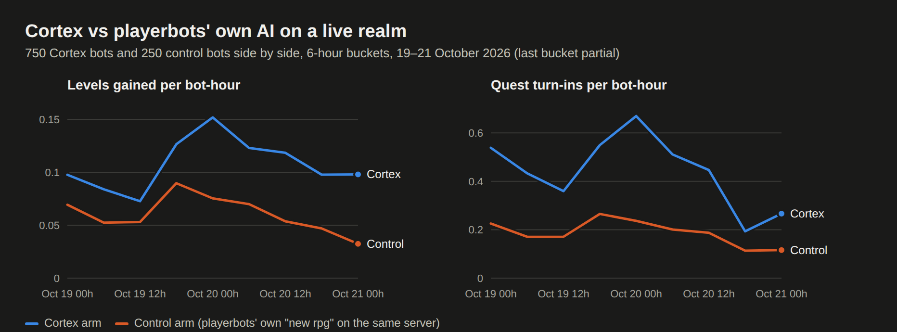
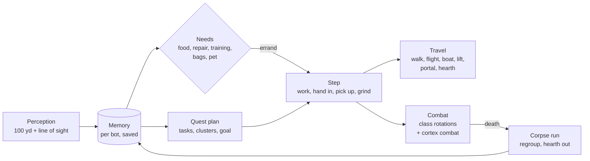

# mod-cortex

**Player-like bots for AzerothCore**

They know how to play the game, not the world. Each bot learns the world from what it sees, and plans its quests the
way a player reads them.

From the live realm's telemetry, before every bot moved to Cortex: 34,000 Cortex bot-hours against 11,800
control bot-hours on the simpler "new rpg" strategy. Cortex bots gained levels 1.8× as fast and turned in 2.4× as
many quests, with 14% fewer deaths.

## What it does

| | |
|---|---|
| **Sees, doesn't read tables** | Perception covers 100 yd with line of sight: NPCs and their services, mobs and their levels, quest sparkles, herb and ore nodes. No spawn or loot table reads, no undiscovered flight points, no teleport unsticks. |
| **Remembers** | Each bot's memory (NPCs, mobs, drops, deaths, places it got stuck, quests it set aside) is saved per bot and survives restarts. |
| **Plans like a quest log** | Quest objectives, map areas and the "!" and "?" markers become tasks. Tasks are grouped into nearby clusters, and the bot picks one goal at a time: work, hand in, pick up or grind. |
| **Looks after itself** | It buys food and water, repairs and trains at NPCs it remembers, binds at inns, hearths, tames a pet, gathers and conjures. |
| **Travels** | It takes known flights, boats and zeppelins, lifts, portals and the hearthstone, planned over a hand-made link table. Routes avoid places where it died lately, and zones where it has seen hostile mobs well above its level. |
| **Comes back from death** | It runs back to its corpse, waits out a camped graveyard, and steps away from the mobs before sitting down. A bot that keeps dying, or dies to mobs far above it, hearths out. |
| **Plays its class** | Class rotations for all nine classes. A caster shoots its wand rather than spend its last mana. A holy priest levels as shadow. Bags are cleared of what has no use and no price. |
| **Plays with you** | Bots join a player's party, follow, assist and take a role; classic raids (Molten Core, Onyxia, BWL, AQ20) and battlegrounds have their own tactics. |

## How it works

Two halves: the **brain** (`src/`) decides what a bot wants to do, the **body** (`src/Body/`) runs the bots and
carries it out (sessions and the random bot population, movement, combat, looting, group play).

- **Brain and body.** The body calls the brain directly (`src/CortexBody.h`): the "cortex" strategy replaces the
  body's simpler "new rpg" questing for every bot under `Cortex.Ratio`. When memory has nothing better, the brain
  falls back on the body's own upkeep, trainer, auction and gathering actions.
- **One switch.** `Cortex.Enable` turns the brain on; `Cortex.Act` lets it play (off, bots only perceive and
  remember). A `Cortex.Ratio` below 1 keeps the rest on "new rpg", as an A/B control.
- **Telemetry.** Every decision writes a row to `cortex_telemetry` (state `c:<goal>`), which drives the bot reports.

## Install

1. Use AzerothCore 3.3.5a from the [Playerbot branch](https://github.com/mod-playerbots/azerothcore-wotlk/tree/Playerbot)
   of AzerothCore: the body needs the module database pool and navmesh settings it adds.
2. Clone into `azerothcore-wotlk/modules/mod-cortex` and build statically (`-DMODULES=static`).
3. Create the `acore_cortex` database (utf8mb4) for the `acore` user. On first start the updater fills it from
   `data/sql/cortex/` and applies the world and characters updates. Then apply `sql/cortex_memory.sql` to it by hand.
4. Copy `conf/mod_cortex.conf.dist` and `conf/mod_cortex_bots.conf.dist` to `etc/modules/` (dropping `.dist`). Set
   `CortexDatabaseInfo` in `mod_cortex_bots.conf` (or env `AC_CORTEX_DATABASE_INFO`) and the bot count
   (`Cortex.Bots.MinRandomBots`, `MaxRandomBots`).
5. Check the startup log for the `Cortex: Enable true, Ratio 1.00, Act true, …` line.

Upgrading from a setup that kept bot data in `acore_playerbots`: `sql/2026_10_22_01_rename_core_tables.sql` before
the first start, and `sql/2026_10_22_00_rename_to_cortex.sql` with the worldserver stopped.

## Configuration

`etc/modules/mod_cortex.conf` (the brain) and `etc/modules/mod_cortex_bots.conf` (the body, `Cortex.Bots.*`). Each
key is documented in its `.dist` file.

| Key | Default | What |
|---|---|---|
| `Cortex.Enable` / `Ratio` | `1` / `1.0` | The brain, and the share of random bots it runs |
| `Cortex.Act` | `1` | Bots play with Cortex (`0`: they only perceive and remember) |
| `Cortex.Perception` / `PerceiveMs` / `SightRange` | `1` / `2000` / `100` | How often and how far a bot looks |
| `Cortex.SaveMinutes` | `5` | Memory save interval (and at shutdown) |
| `Cortex.Tame`, `Gather`, `Sparkles` | `1` | Hunters tame; gathering detours; quest objects |
| `Cortex.Watchdog` / `Escape` | `1` | Idle and stuck watchdog; off-mesh island escape |
| `Cortex.CorpseRun` | `1` | Run back to the corpse instead of the random-bot revive teleport |
| `Cortex.Regroup` | `1` | Step away from the mobs after a revive; hearth out of death loops |
| `Cortex.Wand` / `TidyBags` / `Talents` | `1` | Wand below 50% mana; clear useless unsellable items; holy priests level as shadow |
| `Cortex.Travel` (`.Flights`, `.LearnFlights`, `.CrossMap`, `.Hearth`) | `1` | Trips other than walking |
| `Cortex.Needs` (`.VendorRange`, `.TrainerRange`, `.Food`, `.Mail`) | `1` | Errands to remembered NPCs |

Log channel `server.loading` at startup. Telemetry events (`plan`, `travel_leg`, `regroup`, `retreat`, `wand`, …) are
described next to their keys.

## Commands

GM commands are under `.playerbots` (e.g. `.playerbots rndbot`). Players give their bots chat commands
("follow", "attack", …). The brain itself has none: it is driven by config and observed through telemetry.

## Status

Live on a private classic realm (expansion 0, level cap 60): every random bot runs Cortex since 2026-10-22, levelling
solo through the old world. Party play, raids and battlegrounds work but have seen little testing. The design and the
milestone log (`docs/bot-ai-overhaul.md`, `docs/cortex-standalone.md`) live in the wowproject repo.

## Credits

The body began as [mod-playerbots](https://github.com/mod-playerbots/mod-playerbots) and its authors' work
(`src/Body/AUTHORS.md`); see `src/Body/README.md`.

## License

GPL-2.0, like AzerothCore. See `LICENSE`.
